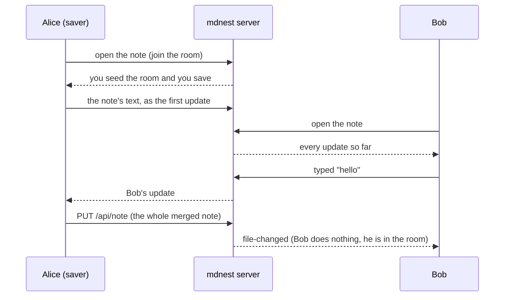

# Live collaboration and shared editing

> **Warning: shared editing works on a single backend only.** Each note's
> editing room lives in the memory of one backend process. With several
> backend replicas, two people in the same note could be connected to
> different backends and would edit two different rooms. Running shared
> editing across replicas needs either sticky routing (everyone in the same
> note reaches the same backend, for example an ingress that hashes on the
> note path) or a shared room store. **Neither is supported yet.** The
> planned route is Redis: the Redis backplane already relays collaboration
> messages between replicas, and room state would move there (or the ingress
> would hash on the note path). Until then shared editing is switched off on
> `MDNEST_ROLE=app`, and the Helm chart switches it off whenever it runs more
> than one backend replica. Those installs keep the older whole-file saves.

Live collaboration (`ENABLE_LIVE_COLLAB=true`, multi-user mode) opens a
websocket from each browser to the backend. Over it people see who else is in
a note, get the sidebar refreshed when files change, and get comments live.
Shared editing builds on that connection so that two people typing in the same
note both keep what they typed.

## The connection

Since v4.8.13 a browser opens one websocket for the whole visit
(`/api/ws?token=...`). Opening a note sends a `join` message on it, with the
note's namespace and path; the server checks access to that note exactly as it
checks any request (grants, groups, path scopes, private chat members) and
answers `joined` (with whether the person may only read) or `join-error`.
Switching notes is one more `join` on the same socket, so a switch never
reconnects. Everything the server sends about a note comes after its `joined`,
so the browser drops anything that belongs to the note it just left. Joins are
limited to a burst of 20, then 20 a second, per socket. The socket closes when
the login it was opened with expires; the browser opens a new one.

If access to a note changes while someone is in it (a grant removed, a member
taken off a private chat), the server takes their socket out of that note and
says so (`note-left`). The rest of the visit keeps its socket, and joining the
note again goes through the check.

A tab left open from before v4.8.13 still uses the older form,
`/api/ws?ns=...&path=...&token=...`, one socket per note, and it keeps
working. The other way round, a new browser against an older backend: when the
token-only socket is refused, or no `joined` comes back within 2 seconds, the
browser uses the per-note form for the rest of the visit.

The toolbar shows one small dot next to the people in the note: green "Live"
while the server answers, grey "Not live" once the socket has been down for
about 2 seconds, with the tooltip "Changes save normally; others won't see your
typing until it reconnects." Nothing else is shown about the connection.

## Editing never waits for the connection

A note opens editable straight away, whatever the connection is doing. Until
the note's shared document is there, the editor saves the normal way (the
whole note, merged with any change made elsewhere meanwhile). When the room is
ready, the editor joins it as it is at that moment:

- an empty room is filled from the editor's own document, so nothing on screen
  changes and the caret stays put;
- a room that already has text is joined at once when you have not changed
  anything yet: you see the room's text, including what others are typing;
- if you have typed (or saved while away from the room), you keep saving the
  normal way. The room's saver merges those saves from the file like any
  outside change, and your editor joins the room as soon as the room holds the
  same text as your editor. Nothing is merged twice;
- if your tab is the room's saver (everyone was away, and you came back
  first), nobody else would merge the file, so your tab does: at the first
  moment all your text is saved, it merges the file into the room's document
  and only then joins. The room already holds everything on your screen, so
  joining takes nothing away and moves nothing.

The caret and the keyboard stay where they were when the editor joins or
leaves the room. If the connection drops while editing together, the editor
leaves the room and goes back to saving the normal way, starting from what the
room last saved; when the connection is back it joins the room again, by the
same rules. The note is read-only
only for someone who may not write to it.

## Why it exists

Before shared editing, every browser saved the whole note about a second after
the last keystroke, and the server only checked that the save was based on the
latest version. When two people typed at the same time, one of them got "This
file was modified by another user", and after a refresh their newest words
were gone. Nothing ever combined two people's edits.

## How it works

Everyone in a note keeps one shared document, using
[Yjs](https://yjs.dev), a library that merges concurrent edits so that every
copy ends up with the same text. The Live editor (Crepe) is bound to that
document, so each keystroke is a small update that is sent to everyone else
and merged into their copy.

The server does not read those updates. It relays them to the other people in
the note and keeps them in memory, so someone who opens the note later gets
the whole document. When the last person leaves and everything was saved, the
room is dropped.

### Who saves

Files stay the source of truth. The note is still written with the ordinary
`PUT /api/note`, but only by one browser in the room, the "saver". The server
picks it: the first person who can write, and later whoever is typing once the
current saver has been quiet for a few seconds. When the saver leaves, the
next person takes over and saves anything that was not saved yet.

The server also checks that the saver is saving. If an update has gone 10
seconds without a save confirming it, the role moves to the writer who was
active most recently, and that browser saves. This covers a saver that is
present on the server but cannot save: a connection the browser has lost
while a proxy keeps the server's side open, or a frozen background tab. The
old saver is not given the role again until it sends something. Before this,
a tab that reconnected quickly could leave its old, dead connection as the
saver, so nothing was saved: the file kept the old text, and coming back to
the note showed the old text and then the room's newer text.

The saver writes only when the editor's text differs from what was last saved.
That is why opening a note and leaving it never rewrites the file, even though
the Live editor would format some markdown differently (for example `*` list
markers become `-`).

When the saver closes the tab right after typing, the text is not lost: the
page sends a last save as it closes (a `keepalive` request, limited by
browsers to 64 KB), and the next saver saves whatever is still different. If
the last person leaves with unsaved text, the server keeps the room for two
minutes and logs a warning, so a quick reload can still save it.

### Changes from outside the room

git-sync, the CLI, an agent through MCP, or a history restore can change the
file while people are editing it. The saver notices and merges the change in.
It notices a change made through the server (a save, `mdnest write`, `edit`,
`append`, `prepend`, an agent, a restore) within about a second, from the
server's `file-changed` message, and also on any refused save. A change that
never goes through the server, such as a git-sync pull or an editor on the
host, sends no message, so the saver also checks the file every 20 seconds.
The merge is a line-based three-way merge of the text the room last saved,
the room's text now, and the file. A part changed on one side takes that side, a part changed
the same way on both sides is taken once, a part where one side is the other
side plus more takes the longer one (the same typing often reaches the file
twice, through the room and through a tab's own save when its connection
dropped), and a part changed differently on both keeps both versions, the
room's first. The result is applied to the
editor as an ordinary edit, so it reaches everyone.

### Front matter

The Live editor does not understand YAML front matter (on save it would turn
the `---` fences into `***` and a heading). In a shared note the front matter
is kept out of the editor: it is split off when the note is loaded, kept as a
separate value in the shared document, and put back in front of the text on
every save, byte for byte. Typing in the note never changes it. An outside
change to the front matter is merged like any other outside change.

### Which notes are shared

Only plain markdown notes opened in the Live editor. These keep the old
whole-file path, unchanged:

- drawings (`.excalidraw.md`),
- chat notes (`mdnest-chat: true`),
- Marp decks (`marp: true`), which are always edited as raw text,
- comments, which have their own API and are not part of the note.

### Basic mode

When someone else is in a shared note, a Basic (plain text) editor switches to
Live and the Basic button is disabled until you are alone again. A textarea
saving its own copy of the note would fight the room. Alone in Basic, the
whole-file save runs as before, and if a room exists its saver merges that
save in like any outside change.

### Read-only viewers

Someone with read access only joins the room to receive it: they see the text
change as others type. The server drops anything a read-only connection
sends, so it is never relayed or stored, and a read-only viewer is never the
seeder or the saver.

### Cursors and undo

Other people's carets and selections show in their colour, with their name.
The name comes from the server's list of who is in the note, not from what
the other browser sends, so nobody can label their cursor as someone else.
Undo and Redo only undo your own edits.

## Limits

| Limit | Value | What happens past it |
|---|---|---|
| People in one room | 32 connections | The next person edits the note the normal way (whole-file saves), not together |
| Update data in one room | 32 MB | Further updates are refused; that person goes back to the normal way |
| Update data across all rooms | 256 MB | Same, for whoever pushes past it |
| Update data from one account, across rooms | 64 MB | Same, for that account |
| One message (a big paste, a snapshot) | 8 MB | The connection closes |

The server asks the saver for a compacted copy of the document once a room's
updates pass 1 MB and four times the last compacted size. The compacted copy
replaces the updates it covers.

Measured with `node frontend/scripts/measure-shared-room.mjs` (two people
typing into a 15 KB note, a save every 40 keystrokes): after 20,000 keystrokes
the room peaked at 1.0 MB of memory (5.1 MB without compaction), after 100,000
at 5.5 MB (83 MB without).

## Turning it on and off

| Setting | Default | Effect |
|---|---|---|
| `ENABLE_LIVE_COLLAB` | `false` | Live collaboration. Multi mode only. Required for shared editing. |
| `SHARED_EDITING` | `true` | Shared editing, when live collaboration is on. `false` keeps whole-file saves for every note. Always off on `MDNEST_ROLE=app`. |

In Helm, `collab.sharedEditing` (default `true`) sets `SHARED_EDITING`, and the
chart forces it to `false` when `backend.replicaCount` is above 1 or autoscaling
is on.

The shared editing code is a separate download (about 46 KB gzipped) that the
browser fetches once, when the server says shared editing is on, so opening a
note never waits for it. An install without live collaboration never loads
it.

## When shared editing is off

With live collaboration on and shared editing off, notes use whole-file saves
with the following protections: a tab with unsaved edits never takes over the
newer version's tag, so its next save is refused and checked instead of
silently overwriting someone else; someone else's live typing is shown but
never counted as your saved text; and the last keystrokes of a burst are
always sent.

## Tests

- `backend/collab/yjs_test.go`: joining gets the whole log, read-only updates
  are dropped, room and server limits, the room is freed on leave (or kept
  when unsaved), saver handover, snapshots, and a saver that does not save
  losing the role (also to a writer who comes back later) while one that
  saves keeps it.
- `tests/browser/content-loss.spec.js` (in both `tests/e2e-collab-multi.sh`
  and `tests/e2e-browser.sh`): type, switch note, come back, and check the
  file on disk, again with every tab closed, and that the server kept no room
  with unsaved updates. One tab switching at once, after 400 ms and after
  2 s; a second tab idle or frozen on the note; the socket dropping; the file
  changed on disk behind the app (a git-sync stash and a reset); and a socket
  the tab lost but the server still holds.
- `backend/collab/connection_test.go` and `backend/routes_ws_session_test.go`:
  the one-socket visit. Every join is checked against grants (path scopes,
  links, `.git`, read-only), switching leaves the old note and its room with
  the budgets returned, the join rate limit, leaving a note when a grant is
  removed or a chat member is taken off, joins refused after the login
  expires, API tokens refused, and the per-note URL still working.
- `tests/browser/live-never-blocks.spec.js` (in `tests/e2e-collab-multi.sh`):
  a note editable within 1 second with the websocket hanging or refused;
  switching notes on one websocket with no status flicker and editable within
  300 ms; a person opening on a slow connection while another types, nothing
  lost; the connection cut mid-edit, typing saved and the room rejoined;
  opening and leaving leaves nothing unsaved on the server; an older backend
  that refuses the token-only socket; a room seeded from the editor holding
  exactly the markdown. `frontend/src/__tests__/collab-visit.test.js` covers
  the browser side of the socket.
- `tests/e2e-collab-multi.sh` runs `tests/browser/collab-shared-editing.spec.js`
  against a real multi-user stack with two accounts: two people typing at
  once, opening and leaving without changing the file, the saver closing the
  tab mid-edit, an outside change merging in, front matter kept, a folder move
  closing the room, and Basic switching to Live. It also runs
  `tests/browser/collab-cli.spec.js`, which drives the real `./mdnest` (logged
  in as the same account as the browser, and as another one): `write`,
  `append`, `prepend` and `edit` show live in a shared note and in Basic mode,
  a git-sync style write to disk shows within the saver's check, and CLI
  changes made while someone types are merged, not written over.
  `collab-idle.spec.js` leaves a note open for a minute and fails on any
  remount, change inside the editor or reconnect. `cli-vs-typing.spec.js`
  has one person typing past the 60-second poll while the CLI appends, and
  fails if the CLI's line is not on disk.
- `frontend/src/__tests__/sharedText.test.js`: front matter split and join, the
  three-way merge, the message format.
